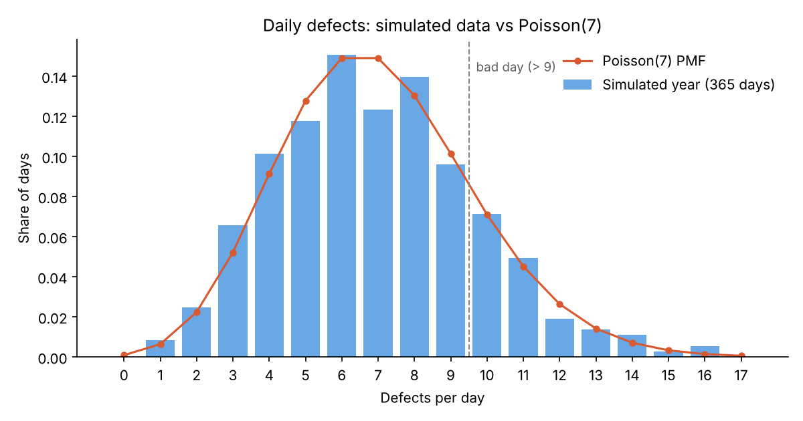

# Detecting Product Defects with Probability

A factory's daily number of defective products follows a **Poisson distribution with λ = 7** (on average, 7 defects per day). This project uses that model to answer practical quality-control questions, then checks the theory against one simulated year of data.



## Questions and answers

### Part 1: the distribution in theory

| Question | Code | Answer |
|---|---|---|
| Chance of exactly 7 defects in a day | `stats.poisson.pmf(7, 7)` | 0.149 (about 15% of days) |
| Chance of a very good day (4 or fewer) | `stats.poisson.cdf(4, 7)` | 0.173 (about 17%) |
| Chance of a bad day (more than 9) | `1 - stats.poisson.cdf(9, 7)` | 0.170 (about 17%) |
| Defect count at the 90th percentile | `stats.poisson.ppf(0.9, 7)` | 10 |

### Part 2: the distribution in practice (`year_defects.csv`)

| Check | Expected | Simulated year |
|---|---|---|
| Total defects in 365 days | 7 × 365 = 2,555 | 2,534 |
| Average defects per day | 7 | 6.94 |
| Worst day | | 16 defects |
| Chance of 16 or more defects in one day | | 0.0024 (about once in 400 days) |
| Share of days with 10 or more defects | about 17% (theory) | 17.3% |

The simulated data matches the model well. The total and the average are close to the expected values, and the bars in the chart follow the Poisson curve.

## What I learned

- **PMF vs CDF:** `pmf(k)` gives the chance of **exactly** k. `cdf(k)` gives the chance of **k or fewer**.
- **"More than" questions** use the opposite event: `1 - cdf(k)`.
- **"k or more"** includes k, so it is `1 - cdf(k - 1)`.
- **Expected value of a Poisson distribution = λ.** A large simulated sample has an average close to λ.
- **Percentiles of discrete data:** `ppf(0.9)` returns 10, but "10 or more" covers about 17% of days, not 10%. Counts jump in whole numbers, so a percentile can't split the data exactly.

## Files

| File | What it is |
|---|---|
| `product_defects.py` | My solution to the 13 project tasks |
| `year_defects.csv` | One simulated year of daily defect counts (columns: `day`, `defects`) |
| `make_data.py` | Creates `year_defects.csv` with a fixed seed, so anyone gets the same data |
| `defects_distribution.png` | The chart above |

## How to run

```bash
pip install scipy numpy
python product_defects.py   # answers all tasks (uses new random data each run)
python make_data.py         # recreates year_defects.csv exactly
```

`product_defects.py` simulates a new year every time it runs, so the numbers in Part 2 will change slightly from run to run. The tables above use the fixed data in `year_defects.csv`.

**Skills:** Poisson distribution, `scipy.stats` (`pmf`, `cdf`, `ppf`, `rvs`), simulation, NumPy.

Project from Codecademy's *Master Statistics with Python* skill path.
